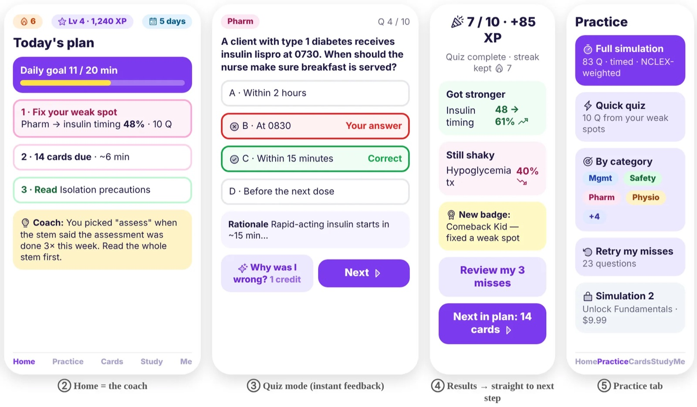

# Preceptor

**Offline-first study app for pre-licensure nursing students.**

`Android in development · iOS planned from the same codebase`

---

An Android study app for nursing students, organized by the 2026 NCLEX-RN Test Plan: practice questions with rationales, flashcard lessons, study pages that can be read aloud, and progress by objective. Content ships with the app, so practice works offline.

## Highlights

- Practice questions with a rationale for every answer
- Flashcard lessons and card quizzes
- Study pages that can be read aloud
- Progress by objective, with an activity map

## Platforms & stack

| Platform | Stack |
|---|---|
| Android | Kotlin 2.4, Compose Multiplatform, Material 3, Room, Koin |
| iOS (planned) | Same Kotlin Multiplatform codebase |

## Screenshots

Concept screens: home, quiz, results and practice

---

This repository is a public showcase: documentation and media only. The source code is proprietary and lives in a private repository.

© 2026 Esteban Ibarra. All rights reserved. See [NOTICE](NOTICE). · [More projects](https://github.com/esteban572) · [estebanibarra.dev](https://www.estebanibarra.dev)
